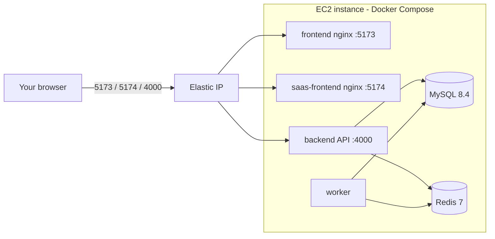

# Deploy HRM PLUS to AWS (one EC2 server, no domain)

> **Author:** Pranta Roy &nbsp;·&nbsp; **Student ID:** 1711232  
> **Paper:** Programming Project (COMPX576)  
> **Programme:** Master of Information Technology, University of Waikato, New Zealand

A complete runbook, **from an empty AWS account to a running system, and then how to update it** with
`git pull`. It puts the whole Docker stack (MySQL, Redis, API, worker, both websites) on a single
EC2 server. There is no RDS, no load balancer and no domain name — that keeps the cost and the
complexity low for a demo or an academic submission.

> New to the project? Read [DEPLOYMENT_GUIDE.md](DEPLOYMENT_GUIDE.md) first for the local setup.
> This page is only about the cloud server.


## At a glance

| Item | Value |
|---|---|
| Server | AWS EC2, Ubuntu 22.04 or 24.04 LTS (x86_64), `t3.medium`, 30 GB gp3 disk |
| Address | An **Elastic IP** (a fixed public address), e.g. `3.25.111.22` |
| What runs | The same `docker-compose.yml` as on your laptop (7 services) |
| Websites | `http://<ip>:5173` (tenant portal) · `http://<ip>:5174` (SaaS site + admin) |
| API | `http://<ip>:4000` (health check at `/health`) |
| Cost | Roughly US$4–8 for 7 days on a `t3.medium` (stop the server between sessions to pay only for hours used) |
| Security | Plain HTTP, one server, no backups — fine for a private demo, **not** for real company data |



## What you need before you start

- An **AWS account** with permission to launch EC2 (a card is required by AWS).
- The **project code** in GitHub (`https://github.com/PrantaRoy/hrm_plus.git`) *or* a source ZIP.
- A computer with a terminal. (Windows 10/11 PowerShell, macOS Terminal and Linux all include `ssh`.)
- About 45–60 minutes.

---

## Step 1 — Launch the server

In the AWS Console choose a **Region** near you (top-right), open **EC2 → Instances → Launch instances**.

| Setting | Choose |
|---|---|
| Name | `hrmplus-demo` |
| AMI | **Ubuntu Server 24.04 LTS** (or 22.04), 64-bit (x86) |
| Instance type | **`t3.medium`** (4 GB RAM; MySQL + Redis + Node + a headless browser share the box). `t3.small` (2 GB) works but is tight. |
| Key pair | **Create new key pair** → name `hrmplus-key`, type RSA, `.pem` → download and keep it safe (you cannot download it again) |
| Network / Security group | **Create security group** with the rules below |
| Storage | **30 GiB gp3** |
| Advanced details → **User data** | Paste the whole contents of `deploy/aws/user-data.sh` from this repo |

**Security group — inbound rules**

| Type | Port | Source | Why |
|---|---|---|---|
| SSH | 22 | **My IP** | You log in to the server |
| Custom TCP | 4000 | My IP *(or `0.0.0.0/0` if others must reach it, e.g. your marker)* | API |
| Custom TCP | 5173 | same as above | Tenant portal |
| Custom TCP | 5174 | same as above | SaaS site and admin |

> **Never** open 3306, 3307 or 6379. `docker-compose.yml` already binds MySQL and Redis to the
> server's own `127.0.0.1`, so they cannot be reached from the internet even if a rule is added by mistake.

Click **Launch instance**.

> **What the user-data script does.** On first boot it installs Docker, the Compose plugin and git, adds
> the `ubuntu` user to the docker group, and creates a 2 GB swap file (a safety margin against
> out-of-memory on a small server). It does **not** install or start the app.

## Step 2 — Give it a fixed address (Elastic IP)

A normal public IP changes every time the server is stopped and started, which would break the
website addresses baked into the app. An Elastic IP does not change.

1. EC2 → **Elastic IPs → Allocate Elastic IP address → Allocate**.
2. Select it → **Actions → Associate Elastic IP address** → choose your instance → **Associate**.
3. Write down the address, for example `3.25.111.22`. Below it is written `<ip>`.

It is free while attached to a *running* instance. An unattached Elastic IP is billed.

## Step 3 — Connect to the server

On your computer, open a terminal in the folder that holds `hrmplus-key.pem`.

```bash
# Mac / Linux only: the key file must be private
chmod 400 hrmplus-key.pem

ssh -i hrmplus-key.pem ubuntu@<ip>
```

Type `yes` if asked about the host's fingerprint. You are in when the prompt shows `ubuntu@ip-...:~$`.

Check the first-boot script finished (give it 1–2 minutes after the first start):

```bash
cat /var/log/hrmplus-bootstrap-done      # prints: user-data bootstrap complete
docker --version                         # prints a version
```

If `docker` says *permission denied*, log out (`exit`) and `ssh` in again so the group change applies.

## Step 4 — Get the code onto the server

**From GitHub (git clone):**

```bash
git clone https://github.com/PrantaRoy/hrm_plus.git
cd hrm_plus
```

**From a ZIP (copy it up, then unzip):** run this on **your computer**, not on the server:

```bash
scp -i hrmplus-key.pem hrm_plus_source.zip ubuntu@<ip>:~/
```

Then on the server:

```bash
sudo apt-get install -y unzip
unzip hrm_plus_source.zip -d hrm_plus
cd hrm_plus
ls                                       # you should see docker-compose.yml, apps, deploy ...
```

If the unzipped files sit inside one extra folder, `cd` into it until `ls` shows `docker-compose.yml`.

## Step 5 — Configure

```bash
cp .env.example .env
chmod +x deploy/aws/*.sh
deploy/aws/set-public-ip.sh <ip>         # points the websites and CORS at your server's address
nano .env                                # set real secrets (below), then Ctrl+O, Enter, Ctrl+X
```

In `.env` **change these before anyone else can reach the server**:

| Setting | What to set |
|---|---|
| `MYSQL_ROOT_PASSWORD` | A long password, **letters and numbers only** (it is placed inside a connection URL) |
| `JWT_ACCESS_SECRET`, `JWT_REFRESH_SECRET`, `JWT_SAAS_ACCESS_SECRET` | Three different long random strings |
| `SETTINGS_ENCRYPTION_KEY` | A random string of **at least 32 characters** |
| `SEED_DEMO` | `true` to create the demo company and accounts (easiest for a demo), or `false` for a clean system |
| `GROQ_API_KEY` (or another provider key) | Optional: lets the "Generate with AI" features work without each company entering a key |
| `SMTP_*` | Optional: real email. Left empty, emails go to a free test inbox instead of real people |

Tip for random secrets: `openssl rand -hex 24` prints a good one.

`set-public-ip.sh` has already rewritten these four lines for your address — check them:

```
VITE_API_BASE_URL=http://<ip>:4000/api
VITE_SAAS_API_BASE_URL=http://<ip>:4000
CORS_ORIGIN=http://<ip>:5173,http://<ip>:5174
FRONTEND_BASE_URL=http://<ip>:5173
```

> **Developer notes.** No domain is used, so `PUBLIC_TENANT_BASE_DOMAIN` and
> `VITE_PUBLIC_TENANT_BASE_DOMAIN` stay `localhost`; subdomain routing is off. The tenant portal
> falls back to `VITE_DEFAULT_TENANT_SLUG` (default `acme`, the demo company) to decide which
> company a visitor is looking at.

## Step 6 — Build and start

```bash
docker compose up -d --build
```

The first build takes about 8–15 minutes on a `t3.medium`. Then watch it come up:

```bash
docker compose ps                        # mysql, redis, backend, frontend, saas-frontend: healthy/running
docker compose logs migrate              # should end with "Demo seed complete" (or finish with exit 0)
curl http://localhost:4000/health        # {"status":"ok"}
```

(`migrate` is a one-time job and shows as *exited (0)* when it succeeded.)

## Step 7 — Open it

From **your own computer's** browser:

| What | Address | Demo login (only if `SEED_DEMO=true`) |
|---|---|---|
| Tenant portal | `http://<ip>:5173` | organisation `acme` · `acme@hrmplus.test` · `1234abcd` |
| SaaS site | `http://<ip>:5174` | — |
| Super-admin | `http://<ip>:5174/admin/login` | `saas@hrmplus.test` · `1234abcd` |
| API health | `http://<ip>:4000/health` | — |

Nothing loads? Check, in order: the instance is **running**; the security group allows your IP on the
port; `docker compose ps` shows the services healthy; the Elastic IP is associated.

---

## Updating a running server (git pull)

```bash
ssh -i hrmplus-key.pem ubuntu@<ip>
cd hrm_plus
git pull
docker compose up -d --build            # rebuilds what changed; the migrate step applies database changes
docker compose ps
```

`git pull` keeps your `.env` (it is not tracked by Git). If you changed the address in `.env`
(for example, a new IP), rebuild the websites because the address is baked in at build time:

```bash
deploy/aws/set-public-ip.sh <new-ip>
docker compose up -d --build frontend saas-frontend
```

Updating from a **new ZIP** instead: upload and unzip it into a *new* folder, copy your old `.env`
into it, then run `docker compose up -d --build` there. To keep the database, keep the **same folder
name** (Docker names its data volumes after the folder) or first take a backup (below).

## Useful server commands

| Task | Command |
|---|---|
| Is everything healthy? | `docker compose ps` |
| Watch API and worker logs | `docker compose logs -f backend worker` |
| Restart one service | `docker compose restart backend` |
| Disk space | `df -h` |
| Memory | `free -h` |
| Back up all databases | `docker compose exec mysql sh -c 'mysqldump -uroot -p"$MYSQL_ROOT_PASSWORD" --all-databases' > backup.sql` |
| Download the backup to your computer | `scp -i hrmplus-key.pem ubuntu@<ip>:~/hrm_plus/backup.sql .` |

Container logs are capped (10 MB × 3 files per service), so they cannot fill the disk.

## Pausing and tearing down

**Pause (keep data, stop paying for compute):** stop the instance in the EC2 console
(*Instance state → Stop*) or run `docker compose stop`. Data stays on the disk. With an Elastic IP the
address is unchanged when you start the instance again.

**Delete everything when the demo is over:**

```bash
docker compose down -v          # removes the database, queue and uploads volumes
```

Then in the AWS Console: **terminate the instance**, **release the Elastic IP**, and delete the
security group and key pair if you no longer need them. An unattached Elastic IP and a leftover disk
are still billed.

## Troubleshooting (AWS specific)

| Problem | Fix |
|---|---|
| `ssh: Permission denied (publickey)` | Use the right key: `ssh -i hrmplus-key.pem ubuntu@<ip>`; on Mac/Linux run `chmod 400 hrmplus-key.pem`; the user is `ubuntu` |
| `ssh` hangs / times out | Port 22 is not open to your current IP — edit the security group (your home IP may have changed) |
| `cat /var/log/hrmplus-bootstrap-done` says no such file | First-boot script still running — wait 2 minutes. If it never appears, run the lines of `deploy/aws/user-data.sh` by hand with `sudo` |
| `docker: permission denied` | `exit` and `ssh` in again (group membership applies on a new login) |
| Build is killed / server freezes | Out of memory — use `t3.medium` or larger, confirm swap with `free -h` |
| Website opens but login does nothing / CORS error | The baked-in address is wrong — `deploy/aws/set-public-ip.sh <ip>` then `docker compose up -d --build frontend saas-frontend` |
| Works, then stops working after the server was stopped | The IP changed because no Elastic IP is attached — attach one, then run the command in the row above |
| Port not reachable from another computer | Security-group source is "My IP" — widen it to `0.0.0.0/0` for that port (demo only) |

More general problems (database passwords, missing modules, and so on): see the Troubleshooting
section of [DEPLOYMENT_GUIDE.md](DEPLOYMENT_GUIDE.md#11-troubleshooting).

## Caveats

- **Plain HTTP, no encryption.** Fine for a private demo link; do not enter real personal data. For real
  use add a domain and HTTPS (a load balancer with a certificate, or Caddy/nginx with Let's Encrypt).
- **Known demo passwords.** `SEED_DEMO=true` creates accounts with the public password `1234abcd`. Set
  `SEED_DEMO=false` if the link could reach anyone beyond the people you invited.
- **One server, no redundancy, no automatic backups.** Take backups yourself (see above).
- **Production would use** a managed MySQL (RDS), managed Redis (ElastiCache), S3 for uploads
  (`STORAGE_DRIVER=s3` and the `AWS_*` settings are already supported by the code), a domain and a
  deploy step in CI. The demo setup intentionally skips them.
