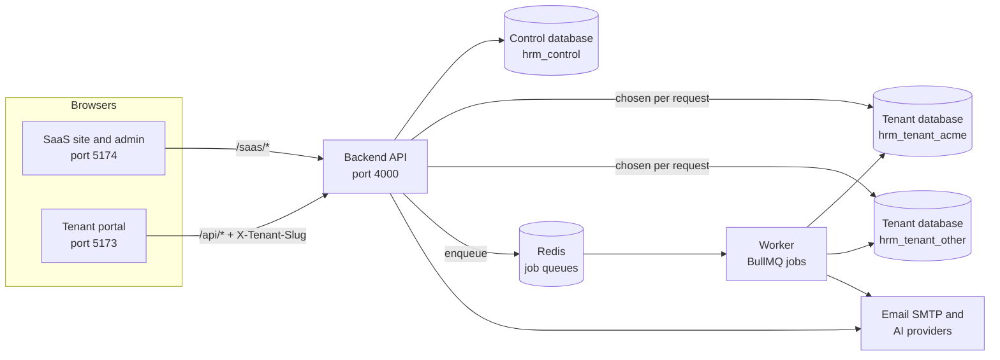
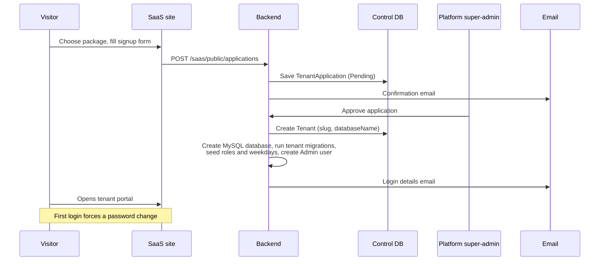
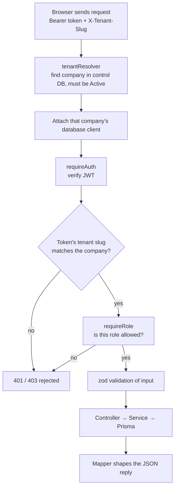
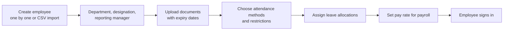
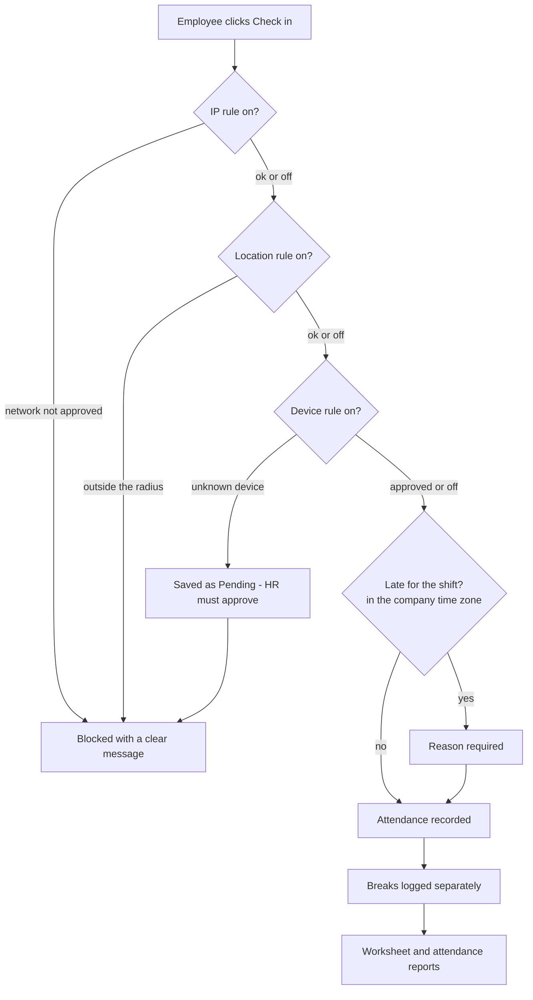
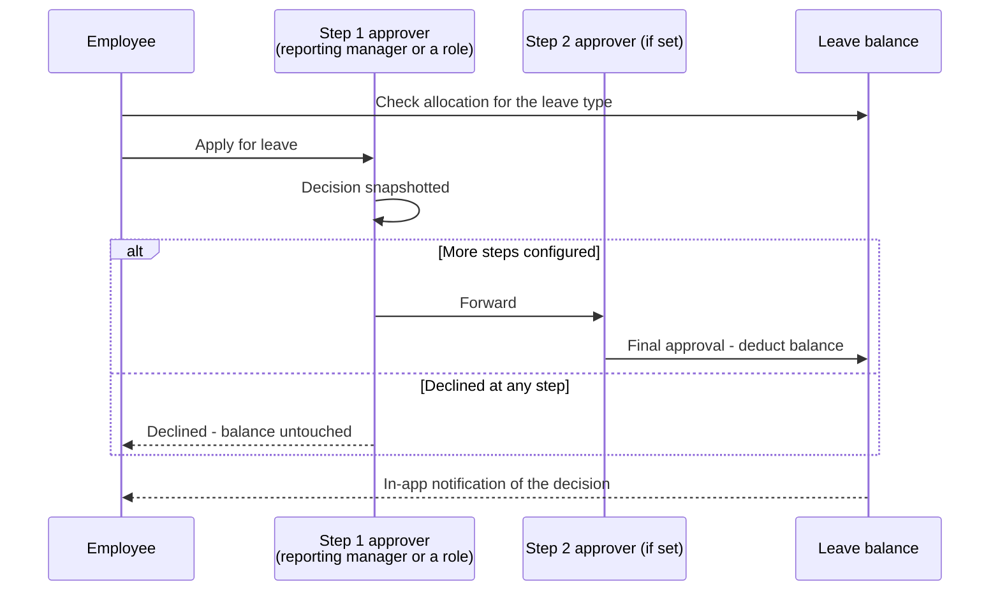
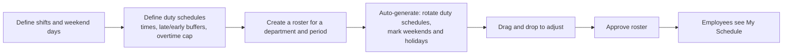
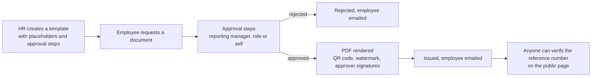
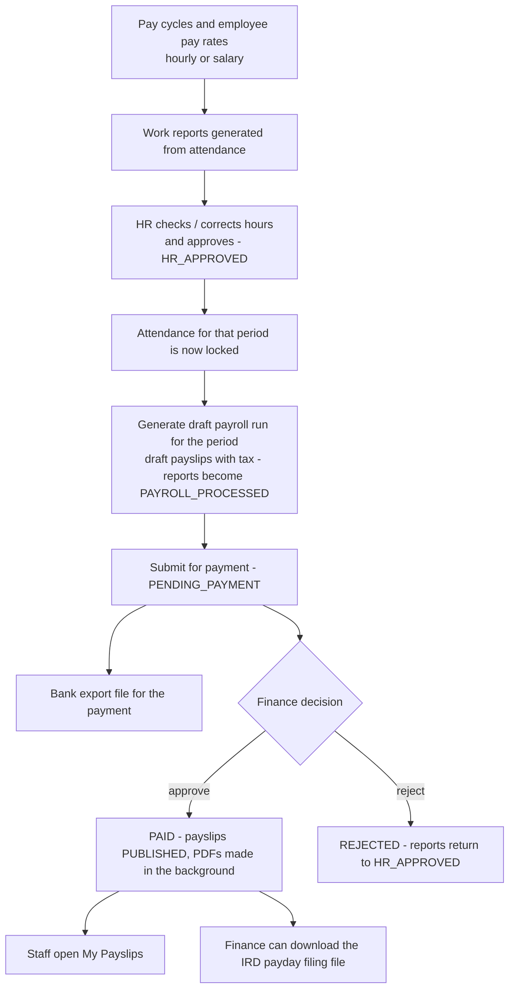
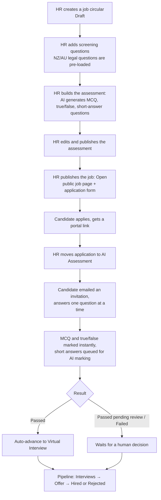

# HRM PLUS — System & User-Journey Workflow

> **Author:** Pranta Roy &nbsp;·&nbsp; **Student ID:** 1711232  
> **Paper:** Programming Project (COMPX576)  
> **Programme:** Master of Information Technology, University of Waikato, New Zealand

How HRM PLUS works, from the point of view of the people who use it and of the code behind it. It
describes the **current, implemented** system. What is not built yet is listed in
[section 14](#14-whats-not-built-yet-the-roadmap), so nothing here should be read as covering a
feature that does not exist.

To install and run the system, see [DEPLOYMENT_GUIDE.md](DEPLOYMENT_GUIDE.md).

**Reading guide.** Each section starts with a plain-English summary ("In short"). The diagrams and
"Technical detail" notes are for developers; non-technical readers can skip them.

## Contents

1. [The big picture](#1-the-big-picture)
2. [Who uses the system (roles)](#2-who-uses-the-system-roles)
3. [A company joins the platform (tenant lifecycle)](#3-a-company-joins-the-platform-tenant-lifecycle)
4. [Signing in and every request (security pipeline)](#4-signing-in-and-every-request-security-pipeline)
5. [Employee onboarding](#5-employee-onboarding)
6. [Attendance](#6-attendance)
7. [Leave](#7-leave)
8. [Duty schedules and rosters](#8-duty-schedules-and-rosters)
9. [Documents](#9-documents)
10. [Payroll](#10-payroll)
11. [Recruitment and AI assessments](#11-recruitment-and-ai-assessments)
12. [Projects, meetings, assets and the rest](#12-projects-meetings-assets-and-the-rest)
13. [Background jobs and cross-cutting rules](#13-background-jobs-and-cross-cutting-rules)
14. [What's not built yet (the roadmap)](#14-whats-not-built-yet-the-roadmap)

---

## 1. The big picture

**In short.** HRM PLUS is one platform that many companies share, but each company's data lives in its
own separate database. A company applies on the public website, the platform owner approves it, and the
system automatically builds that company's private workspace. Staff then use the *tenant portal*
(attendance, leave, rosters, payroll, recruitment, projects…). Slow jobs such as PDF payslips and AI
marking run in the background.

```
apps/backend         Express + TypeScript API (Prisma ORM, MySQL) and the background worker
apps/frontend        Tenant portal: the daily app for one company's staff (React + Vite + Tailwind)
apps/saas-frontend   Public landing/signup site + super-admin portal (React + Vite + Tailwind)
packages/shared      TypeScript types shared by all three apps
packages/ui          Shared design-system components
```



**Technical detail — multi-tenancy.** Database-per-tenant. One **control database** holds the platform
data (tenants, platform admins, packages, applications, support tickets, landing-page content). Each
company gets its own physical MySQL database, `hrm_tenant_<slug>`, holding employees, attendance, leave,
rosters, payroll, recruitment, projects and so on. There is no shared `tenant_id` column that a forgotten
filter could leak, and isolation is covered by automated tests (`tenantIsolation.test.ts`).

---

## 2. Who uses the system (roles)

| Role | Typical person | Main powers |
|---|---|---|
| **Platform super-admin** | The platform owner | Packages, signup applications, company list, support tickets, landing-page CMS (uses the SaaS site, separate login) |
| **Admin** | Company owner / IT | Everything inside the company, including AI settings and support tickets |
| **HR** | HR officer | Employees, leave, rosters, recruitment, documents, work reports and pay cycles |
| **Manager** | Team lead | Approves leave and documents for their team, builds rosters, meetings, projects |
| **Staff** | Everyone else | Own attendance, leave, schedule, payslips, tasks |
| **Payroll / Finance** | Payroll clerk, accountant | Pay cycles and work reports (Payroll), payroll runs and bank export (Payroll, Finance) |

| Capability | Admin | HR | Manager | Staff | Payroll | Finance |
|---|:-:|:-:|:-:|:-:|:-:|:-:|
| Own attendance, leave, payslips | ✔ | ✔ | ✔ | ✔ | ✔ | ✔ |
| Employees and settings | ✔ | ✔ | view | – | – | – |
| Rosters and duty schedules | ✔ | ✔ | ✔ | own | own | own |
| Recruitment | ✔ | ✔ | – | – | – | – |
| Work reports and pay cycles | ✔ | ✔ | – | – | ✔ | – |
| Payroll runs | ✔ | – | – | – | ✔ | ✔ |
| AI settings and support tickets | ✔ | – | – | – | – | – |

Each company can edit its own roles. The server re-checks every request (`requireRole`); hiding a
screen in the browser is a convenience, never the security boundary.

---

## 3. A company joins the platform (tenant lifecycle)

**In short.**

1. The platform owner creates **packages** (a name, a price — free or paid — and how many days it lasts).
2. A visitor opens the public site, picks a package and fills in the signup form. This creates a
   *Pending* application and sends a confirmation email.
3. The owner reviews it and **approves** (or rejects) it.
4. On approval the system builds the company's private workspace and emails the login details. The new
   Admin signs in with the temporary password `12345678` and must choose a new one immediately.
5. The owner can later **deactivate** a company, which blocks all access to it at once.



**Technical detail.** `approvalService.ts` drives it; `tenantProvisioning.ts` creates the database
(`createTenantDatabase`), applies `prisma/tenant/migrations` (`runTenantMigrations`, which shells out to
`prisma migrate deploy`), and seeds default data (roles, weekdays, screening questions, website
sections). A deactivated tenant answers `404` exactly like an unknown one, so its existence is not leaked.
The super-admin API (`/saas/*`) uses a **separate JWT secret**, so a company token can never act as
platform owner.

---

## 4. Signing in and every request (security pipeline)

**In short.** A user types their organisation name, email and password. After signing in, every action
the browser performs carries a secure token and the company name, and the server checks both before it
touches any data.



- **Login screens:** tenant login at `/login`; super-admin at `/admin/login` on the SaaS site.
- **Passwords:** hashed with bcrypt. A new Admin must change the temporary password. "Forgot password" sends a
  reset link by email.
- **Two token families:** tenant users and platform admins have different secrets, so one can never be used
  in place of the other.
- **Replay protection:** the token carries the company name; if someone swaps the `X-Tenant-Slug`
  header, the mismatch is rejected.
- **Errors are consistent:** services throw typed errors (400, 401, 403, 404, 409, 410); one handler turns
  them into JSON and hides internals behind a generic 500.

Each backend feature follows the same files: `*.routes.ts` → `*.controller.ts` → `*.service.ts` →
`*.mapper.ts` (reply shape) with `*.schemas.ts` (zod validation).

---

## 5. Employee onboarding

**In short.** An Admin or HR person adds a new employee, places them in the organisation, uploads
their documents, sets how they may clock in and gives them leave. The new person can then sign in and
appears in rosters and attendance.



Screens: *Employees → list / create / detail*, with panels for documents, leave allocations,
attendance methods, attendance restrictions and pay rates. **CSV bulk import** validates every row and
reports errors per row before saving.

---

## 6. Attendance

**In short.** Staff clock in and out from their dashboard, by QR code at a kiosk, or a manager enters
the time for them. HR can restrict *where* and *from what* people may clock in. Late arrivals and early
departures need a typed reason. Breaks are recorded too.



- **Methods:** online check-in/out, QR-code kiosk, manual entry by a manager.
- **Restrictions (per employee):** approved networks (CIDR), geofence (distance by the haversine
  formula), approved devices. The first failing rule stops the request.
- **Time zone:** whether someone is "late" is judged in the company's configured time zone (Settings →
  General), not UTC.
- **Resuming:** an accidental check-out can be resumed before the shift ends; the gap is logged as a break.
- **No scheduler:** days nobody clocked into are marked *Incomplete* the next time attendance is read.
- **Payroll lock:** once HR approves a work report, the attendance it covers cannot be changed (see §10).

Key code: `attendance.service.ts`, `attendanceRestrictions.service.ts` (`enforceIpRule`,
`enforceLocationRule`, `enforceDeviceRule`), `attendanceQr.service.ts`.

---

## 7. Leave

**In short.** An employee checks their balance, asks for leave, and the request travels through an
approval chain. Only the final approval deducts the balance.



Leave types, allocations per employee and approval chains (`LeaveApprovalStep`) are configurable. Each
decision is **snapshotted** (`LeaveRequestApproval`), so renaming a role later never rewrites history.
Approved leave marks the employee's rostered days as *On leave*. Screens: *Apply Leave*, *My Leave
Requests*, *Leave Approvals*, plus the *Holiday calendar*.

---

## 8. Duty schedules and rosters

**In short.** Managers define shifts, then generate a draft roster for a department and period. The
system rotates the schedules across employees and marks weekends and public holidays as days off.
The manager adjusts it by dragging, then approves it. Employees see the approved roster in **My
Schedule**.



Generation is one database transaction (it all succeeds or nothing changes) and refuses to overlap an
assignment from another roster. See §14 for the planned rest-break and availability rules.

---

## 9. Documents

**In short.** Staff request documents such as a salary certificate or employment letter. The request
follows an approval chain, and once approved the system produces the PDF with a QR code; anyone can
check the document's reference number on a public verification page.



Request statuses: Pending → Approved → **Issued** (or Rejected / Cancelled). The verification page shows only
"valid" or "not valid" plus the document type, recipient name and issue date — never salary figures or
content. Screens: *Document templates*, *Request document*, *My requests*, *Document approvals*.

---

## 10. Payroll

**In short.** Each pay period, HR approves every employee's hours, the system turns the approved hours
into draft payslips (with income tax), the Payroll role submits the run for payment, Finance approves
it, and the payslips become visible to staff as PDFs.



- **Tax:** NZ and AU progressive income-tax tables, chosen by the company's payroll region; an overtime
  multiplier applies to extra hours.
- **PDF payslips and the IRD filing file** are produced by the worker (Chromium renders the PDF).
- **Not included:** deductions beyond tax, bonuses, allowances and pension (see §14).

---

## 11. Recruitment and AI assessments

**In short.** HR publishes a job circular. Candidates apply on a public page and answer screening
questions. HR can have the AI write a skills quiz from the job description. Candidates take the quiz by
email link; the system marks it (the AI marks written answers) and moves strong candidates forward.
HR runs the rest of hiring on a drag-and-drop board.



- **Pipeline stages:** Application Received → AI Assessment → Virtual Interview → In-Person Interview →
  Offer → Hired / Rejected. Every move is recorded in a stage history.
- **Scoring:** the score is calculated over *all* questions, so an unanswered question counts as zero.
  A clear pass is **Passed**; a borderline score, or a quiz made mostly of written answers, is **Passed
  pending review**; a low score is **Failed**. Nobody is rejected automatically.
- **AI:** each company picks its own provider (Groq, Gemini, OpenAI or Anthropic) in *Settings → AI*; the
  API key is stored encrypted (AES-256-GCM). If a company sets none, the server's fallback key from
  `.env` is used. The AI's JSON reply is validated before anything is saved.
- **Candidates** use a secure link (portal token) to follow or withdraw their application; links expire.

---

## 12. Projects, meetings, assets and the rest

| Area | What it does |
|---|---|
| **Projects and tasks** | Clients, projects, tasks with checklists, comments, attachments, followers; time entries with a start/stop timer (one running timer per person); recurring tasks created by the worker; a *My Work* dashboard; sticky notes. Access is by role plus project/task membership. |
| **Meetings** | A scheduler that checks every invited person's roster assignment, approved leave, holidays and existing meetings, shows conflicts, and stores a conflict snapshot when the meeting is confirmed. Statuses: Draft → Confirmed / Cancelled; invitees Accept or Decline. |
| **Assets** | Register of company property with assignment history, the asset's condition when handed out and returned, an offboarding checklist, and daily reminders 30 and 7 days before warranty, registration, WoF/CoF or test-and-tag dates expire. |
| **AI KPI reports** | Authorised managers (not regular staff) generate a performance report for an employee, department or designation over the last 2 or 4 weeks or a custom range; the AI writes a short assessment from the KPI figures. |
| **Support tickets** | A company raises a ticket to the platform owner; both sides reply; the owner sets the status (Pending, Open, Hold, Closed); email notifications go out. |
| **Notifications** | An in-app bell list (currently created for leave decisions) plus emails for signups, document steps, asset expiry, assessment invitations and tickets. |
| **Company website CMS** | Each company can edit its own public website: hero slides, services, gallery, blog, legal pages, social links. |
| **Landing-page CMS (platform)** | The super-admin edits the marketing landing page, blog and contact inbox on the SaaS site. |
| **Reports** | Attendance report (date range, department), leave report, worksheet, payroll run detail, AI KPI reports, the recruitment pipeline board. |

---

## 13. Background jobs and cross-cutting rules

**Worker queues** (BullMQ on Redis, run by the separate `worker` process; failed jobs retry 3 times with
exponential back-off):

| Queue | Job |
|---|---|
| `assessmentGrading` | Marks a candidate's written answer with the AI |
| `assessmentExpiry` | Expires assessment invitations past their deadline |
| `payslipPdf` | Renders payslip PDFs |
| `irdPaydayFiling` | Produces the IRD payday filing file |
| `assetExpiryReminder` | Daily check; emails before asset expiry dates |
| `recurringTasks` | Generates the next copy of recurring tasks |

**Rules that apply everywhere**

- **Isolation:** one database per company; token and header must agree.
- **Validation:** every input is checked with zod; errors come back as a clear `400`.
- **Files:** uploads go through one storage layer that can write to a local folder (default) or Amazon S3
  (`STORAGE_DRIVER=s3`).
- **Email:** real SMTP when configured; otherwise a free test inbox (preview link in the logs).
- **Protection:** security headers (Helmet), CORS allow-list, rate limits on the public contact forms,
  HTML sanitising of free text.
- **Logging:** structured logs (pino). Container logs are capped so they cannot fill the disk.
- **Time zones:** each company has a time zone; shift times are wall-clock in that zone.
- **Testing and CI:** a backend suite of 496 test cases (unit + integration against real temporary
  databases) runs in GitHub Actions together with type-checking, linting and the production builds.

---

## 14. What's not built yet (the roadmap)

The system covers the core of the original proposal. These items are known gaps or planned work.

**Planned next** (each already has a working foundation in the code):

| Item | Today | Next step |
|---|---|---|
| Bulk attendance import (CSV/Excel) | Employee CSV import with row-level errors; manual attendance entry | Reuse the importer for attendance rows |
| Constraint-based rosters | Rotation, weekend/holiday handling, overlap detection, overtime cap | Add availability, minimum rest between shifts, maximum weekly hours |
| Digitally signed PDFs | Approval chain, signature images, QR, public verification | Certificate-based signature on the PDF |
| Performance review cycles | AI KPI reports | Review cycles, manager remarks, AI-drafted reviews |
| Roster-change notifications | Notification service used for leave | Notify on roster approval and assignment changes |
| Audit-grade logging | `AuditLog` table; written by the IRD filing only | One shared service logging approvals, document access, payroll and data changes |
| Live IRD payday filing | IRD-shaped file including each employee's IRD number | Submit through IRD's service once credentials exist |

**Not started:** offline attendance with background sync · payroll deductions, bonuses, allowances and
pension · candidate appeal for AI screening · attrition-risk flagging · scheduled asset condition
assessments · meeting-request notifications and push delivery · consolidated asset/recruitment
reports · onboarding checklist · staff complaints · multiple languages and full-text search · NZ/AU
rest-break and holiday-pay rules · HTTPS/domain, managed database and staging environment ·
end-to-end browser tests.

**Known issue:** one backend test (`TC-0129`, a manual time entry on the task timer) was failing in the
4 October 2026 run and is open.
