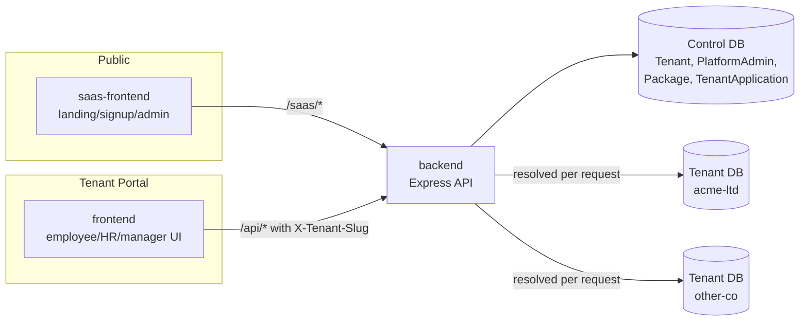
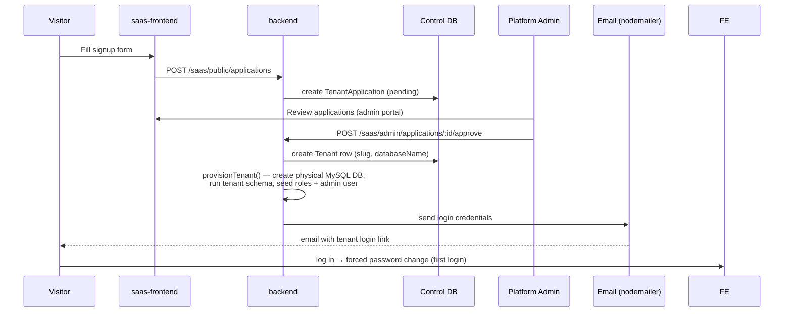
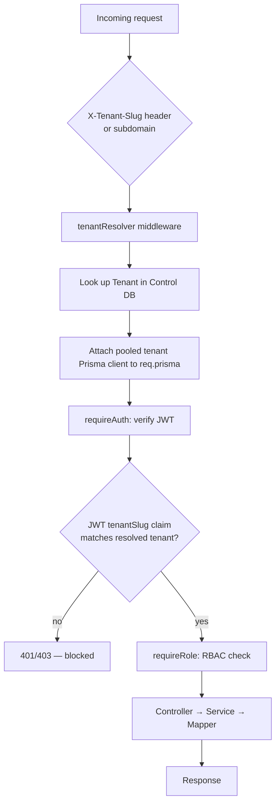
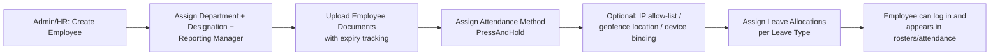
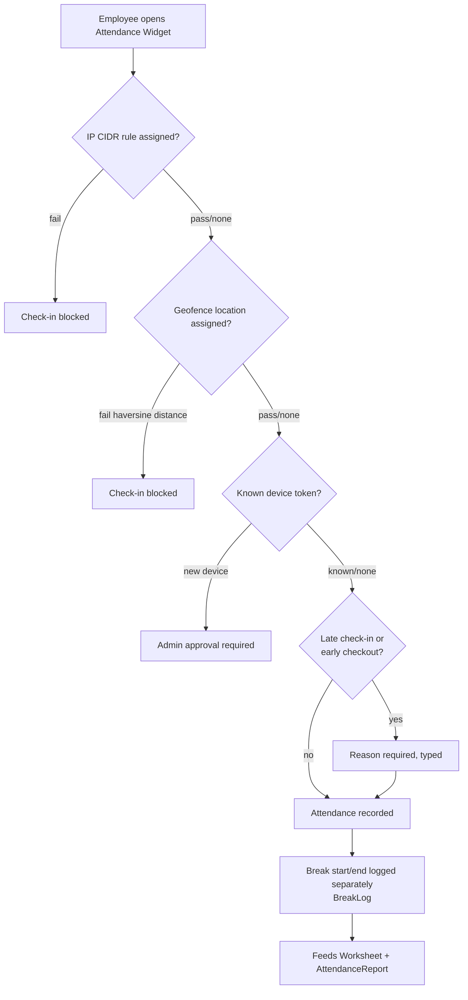
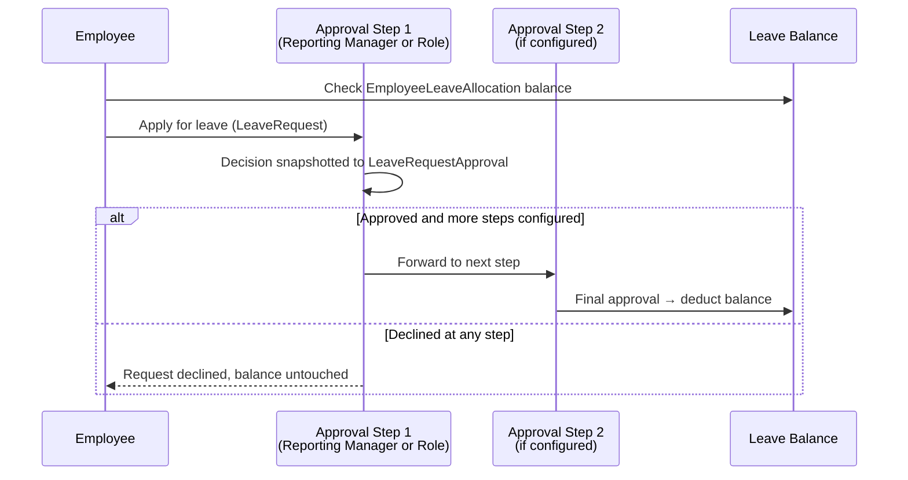
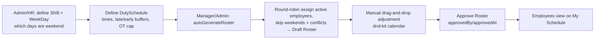

# HRM PLUS — System & User-Journey Workflow

This document describes how requests and data actually flow through the **current, implemented** HRM PLUS codebase — not the aspirational full scope of the original proposal. Section 10 lists what the proposal describes that has no code yet, so the rest of this document isn't misread as covering features that don't exist.

---

## 1. Architecture at a Glance

Monorepo (npm workspaces):

```
apps/backend        Express + TypeScript API (Prisma ORM, MySQL)
apps/frontend        Tenant employee/HR portal (React + Vite + Tailwind)
apps/saas-frontend    Public landing/signup + super-admin portal (React + Vite + Tailwind)
packages/shared       Shared TS types/DTOs
packages/ui           Shared design-system components
```

**Multi-tenancy = database-per-tenant.** There is one **control-plane database** (tenant registry, packages, applications, platform admins) and one **physical MySQL database per tenant** (employees, attendance, leave, rosters, etc.), provisioned on approval.



Each tenant's data is physically isolated in its own database — there's no shared `tenant_id` column to accidentally leak across. This is verified directly by `apps/backend/src/__tests__/tenantIsolation.test.ts`.

---

## 2. Tenant Lifecycle Workflow (SaaS Control Plane)

This is how a new organisation gets onto the platform in the first place.



Key files: `apps/saas-frontend/src/pages/public/*`, backend `modules/tenants/tenantProvisioning.ts`, `scripts/provision-tenant.ts`, `modules/notifications/email.service.ts` (falls back to Ethereal test inbox in dev — no real email required for demoing).

The super-admin portal also manages **Packages** (subscription tiers) and can activate/deactivate tenants after provisioning.

---

## 3. Request-Level Workflow (every `/api/*` call)

Every authenticated tenant-scoped request goes through the same pipeline:



Two important isolation details:
- **Two separate JWT secret pairs** — one for tenant users (`JWT_ACCESS_SECRET`/`JWT_REFRESH_SECRET`), one for SaaS/platform admins (`JWT_SAAS_ACCESS_SECRET`). A tenant login token cannot be reused against `/saas/*`, and vice versa.
- The `tenantSlug` embedded in the JWT is cross-checked against the tenant resolved from the request header/subdomain — a stolen token from tenant A cannot be replayed against tenant B even if the attacker swaps the header.

Backend modules consistently follow `*.routes.ts → *.controller.ts → *.service.ts → *.mapper.ts (DTO shaping) → *.schemas.ts (zod validation)`.

---

## 4. Employee Onboarding Workflow



Admin/HR-only screens: `apps/frontend/src/pages/employees/*` (List, Create, Detail, Documents panel, Leave Allocations panel, Attendance Methods panel, Attendance Restrictions panel).

---

## 5. Attendance Check-In / Check-Out Workflow



Notable implementation detail: there's no cron/scheduler. Days an employee never checked into are lazily swept and marked "Incomplete" **the next time attendance is read**, not on a timer — worth knowing if you're asked about background job infrastructure.

Key files: `components/attendance/AttendanceWidget.tsx`, `pages/attendance/AttendanceLocation*`, `pages/settings/AttendanceSettings.tsx`, `AttendanceIpRuleSettings.tsx`, backend `attendance.service.ts`.

---

## 6. Leave Application & Approval Workflow



Approval chains (`LeaveApprovalStep`) are configurable per leave type/allocation, and each approver in the chain can be either "the requester's reporting manager" or "a specific Role." Each individual decision is **snapshotted** into `LeaveRequestApproval` at approval time — so if a role gets renamed later, historical approval records still read correctly.

Frontend: `pages/leave/ApplyLeave.tsx`, `MyLeaveRequests.tsx`, `LeaveApprovals.tsx`.

---

## 7. Duty Schedule & Roster Workflow



Key files: `pages/rosters/*`, `pages/duty-schedules/*`, `MySchedule.tsx`, `DutyScheduleMonthCalendar.tsx`, `pages/rosters/components/DroppableCell.tsx`, `CalendarGrid.tsx`.

---

## 8. Reporting Workflow

`AttendanceReport.tsx`, `LeaveReport.tsx`, and `Worksheet.tsx` call backend aggregation endpoints (`listAttendance()`, `getWorksheet()` in `attendance.service.ts`), always scoped to the single tenant database resolved for that request. There is currently no cross-module reporting (e.g. nothing joins payroll or performance data, since those modules don't exist yet) and no cross-tenant reporting (by design — tenant isolation).

---

## 9. Cross-Cutting Concerns

- **RBAC**: enforced twice — server-side via `requireRole()` middleware on routes, and client-side via `RequireAuth roles={[...]}` wrapping route definitions in `App.tsx` (UI gating is a convenience, not a security boundary — the server check is what actually protects data).
- **Multi-tenancy isolation**: enforced structurally (database-per-tenant) rather than by a filter that could be forgotten in a query; explicitly regression-tested in `tenantIsolation.test.ts`.
- **Audit logging**: the `AuditLog` model exists in the tenant Prisma schema, but a repo-wide search found **no code currently writing to it** — it's schema-ready infrastructure, not an active feature yet. Worth flagging if the proposal's "all sensitive actions must be logged" NFR comes up in review, since it's not true of the current build.

---

## 10. Gaps vs. the Original Proposal

Not implemented yet — no models, routes, or pages exist for these, so no workflow can be described for them:

- **Payroll** (cycles, deductions/bonuses, loans, insurance/pension)
- **Document generation engine** — today, `EmployeeDocument` only supports *uploading and storing* existing files (local disk or S3) with expiry tracking; there is no template-driven PDF generation (salary certificates, offer letters, digital signatures) as the proposal describes
- **Recruitment / AI-assisted candidate screening**
- **Performance reviews / AI-assisted drafting / attrition-risk flagging**
- **Meetings / appointments**
- **Asset register**
- **Real-time / in-app notifications** — only transactional email exists today (signup confirmation, application approval, password reset); no in-app/push notification model or UI
- **Redis** — provisioned in `docker-compose.yml` but not referenced anywhere in backend code (reserved for future use — likely candidate for the notifications/real-time work above)

Everything in Sections 2–8 above reflects real, working, tested code as of the latest commit (`a74db8c`, "attendance method and check in/out").
